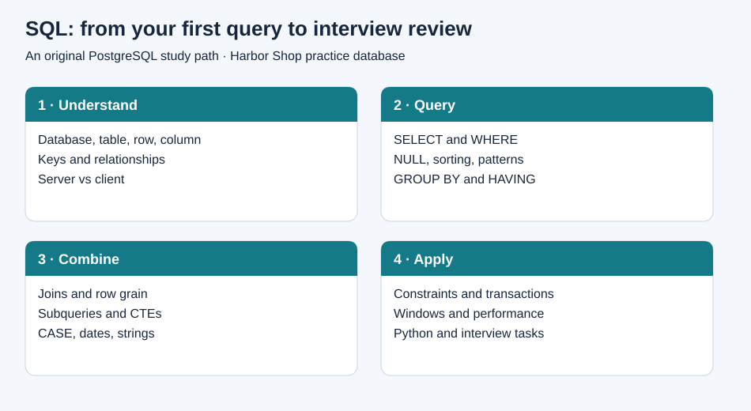
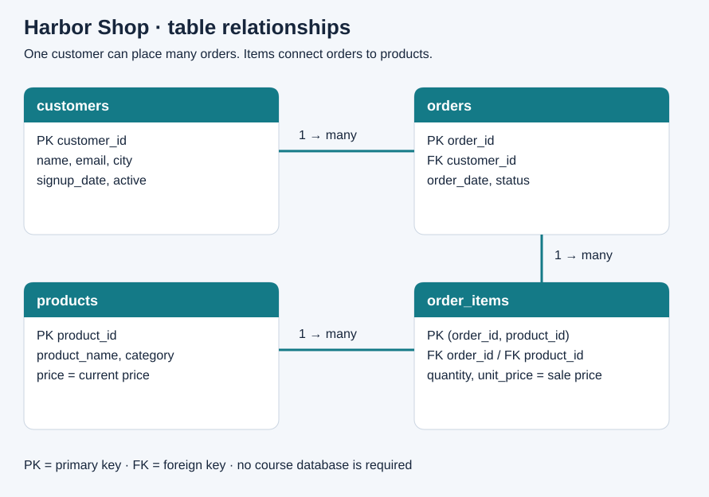

# SQL Course Cheat Sheet · PostgreSQL

There are many database systems: PostgreSQL, MySQL, SQLite, Microsoft SQL Server, Oracle, and others. **This tutorial uses PostgreSQL.** SQL is the language; PostgreSQL is the software that stores data and executes that language. SQL concepts transfer between systems, but date functions, auto-generated IDs, case sensitivity, and other syntax can differ.

PostgreSQL is free, open source, and available on macOS, Linux, and Windows. It is a useful learning choice because it supports everyday relational queries, reliable transactions, constraints, and advanced analysis with window functions. There is no PostgreSQL software licence fee; hosting and support can still cost money. See the [official overview](https://www.postgresql.org/about/) and [licence](https://www.postgresql.org/about/licence/).

**Purpose:** an original personal study companion, runnable practice lab, and interview refresher. Topic selection was informed by the supplied outline of *The Complete SQL Bootcamp: Go from Zero to Hero*. This is not a transcript, official course resource, or claim to reproduce every lecture. All explanations, shop data, exercises, and diagrams here were created for this repository. No course screenshots, course PDF, or third-party diagram is redistributed.



## Start here

1. [Install PostgreSQL and pgAdmin on macOS](docs/01-macos-setup.md).
2. Create an empty database called `sql_practice`.
3. In its pgAdmin Query Tool, open and execute `sql/00_schema.sql`, then `sql/01_seed.sql`.
4. Work through the linked chapters below. Run queries one at a time to inspect results.
5. Before an interview, review the [quick reference](CHEATSHEET.md), [interview guide](docs/13-interview-review.md), and [exercises](exercises/QUESTIONS.md).
6. [Publish this folder on GitHub](GITHUB_SETUP.md).

The SQL targets PostgreSQL 16+ using features common to recent supported releases. Installation instructions were checked against official sources on 2 October 2026; installer compatibility can change.

## Tutorial contents

| Chapter | What you learn |
| --- | --- |
| [01 · Mac setup](docs/01-macos-setup.md) | Server vs client, installation, connection, loading data, backup/restore |
| [02 · Foundations](docs/02-foundations.md) | Tables, rows, keys, relationships, normalization, data types |
| [03 · Selecting and filtering](docs/03-select-and-filter.md) | SELECT, DISTINCT, WHERE, logic, NULL, IN, BETWEEN, LIKE, sorting |
| [04 · Aggregation](docs/04-aggregation.md) | COUNT, SUM, AVG, GROUP BY, HAVING, conditional aggregation |
| [05 · Joins and sets](docs/05-joins-and-sets.md) | INNER/LEFT/RIGHT/FULL/CROSS/self joins, anti joins, UNION |
| [06 · Functions and dates](docs/06-functions-and-dates.md) | Strings, math, timestamps, intervals, casts, time zones |
| [07 · Subqueries and CTEs](docs/07-subqueries-and-ctes.md) | Scalar/list/correlated subqueries, EXISTS, readable multi-step analysis |
| [08 · Tables and changes](docs/08-tables-and-changes.md) | CREATE, constraints, INSERT, UPDATE, DELETE, ALTER, DROP |
| [09 · Conditional expressions](docs/09-conditional-and-views.md) | CASE, COALESCE, NULLIF, views, functions, procedures |
| [10 · Transactions](docs/10-transactions.md) | ACID, COMMIT, ROLLBACK, savepoints, concurrency |
| [11 · Window functions](docs/11-window-functions.md) | ROW_NUMBER, RANK, DENSE_RANK, LAG, running totals |
| [12 · Performance and Python](docs/12-performance-and-python.md) | Indexes, EXPLAIN, safe Psycopg queries |
| [13 · Interview review](docs/13-interview-review.md) | Definitions, answer patterns, SQL traps, revision schedule |

## Repository contents

- `docs/`: full tutorial, definitions, syntax, examples, pitfalls, small challenges.
- `sql/00_schema.sql` and `sql/01_seed.sql`: original four-table practice database.
- `sql/02_examples.sql`: numbered read-only example queries.
- `sql/03_modification_lab.sql`: reversible change practice inside a transaction.
- `sql/04_functions_and_views.sql`: reusable database objects for chapter 9.
- `sql/99_reset.sql`: explicitly destructive reset of these practice tables.
- `assets/`: four original SVG illustrations, plus Mermaid diagrams in the chapters.
- `exercises/`: 15 independent challenges, worked solutions, and expected results.
- `tests/verify.sql`: PostgreSQL checks for seed data, joins, and interview solutions.
- `python/query_customers.py`: parameterized database access with Psycopg 3.
- `CHEATSHEET.md`: compact syntax refresher.
- `GITHUB_SETUP.md`: web and Terminal publishing instructions.
- `VALIDATION.md`: checks performed and how to validate on PostgreSQL.
- `SOURCES.md`: official documentation links and provenance.

## Practice data

Our fictional **Harbor Shop** sells stationery and desk accessories. Each order can contain several products. Order items store the price at the time of purchase; do not recalculate historical revenue using today's product price.



Baseline: **5 customers, 5 products, 6 orders, 9 order items**. Four orders are paid, one is pending, and one is cancelled. Unless a question says otherwise, revenue means paid orders only. Paid revenue is **€189.50**.

Optional Terminal workflow, from this folder:

```bash
psql -h localhost -U postgres -d sql_practice -v ON_ERROR_STOP=1 -f sql/00_schema.sql
psql -h localhost -U postgres -d sql_practice -v ON_ERROR_STOP=1 -f sql/01_seed.sql
psql -h localhost -U postgres -d sql_practice -v ON_ERROR_STOP=1 -f tests/verify.sql
```

Enter the database password when prompted. If `psql` is unavailable in Terminal, use pgAdmin or see chapter 1. The schema and seed scripts are intended for an empty practice database, not repeated loading into existing tables.

## How to study

Read a definition, predict the output, run the example, then change one part of the query. Explain the result aloud. Solve an exercise without viewing its answer. Keep your own notes under a new `my-notes/` folder and commit them as you learn.

The review chapters include extra interview material beyond the supplied course outline. PostgreSQL-specific features are identified where relevant. This repository is not endorsed by Udemy or the course instructor.
