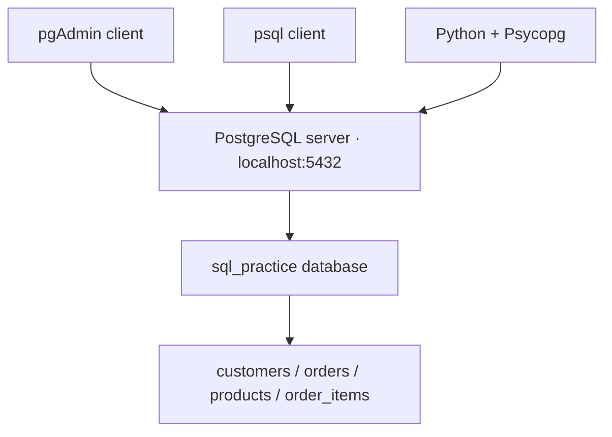

# 01 · PostgreSQL and pgAdmin on macOS

[Home](../README.md) · [Next: foundations](02-foundations.md)

## What gets installed?

**PostgreSQL server** stores the database and runs queries. **pgAdmin** is a graphical client that connects to the server. **psql** is a command-line client. Installing pgAdmin alone does not install or start a database server.



## 1. Check your Mac

Open **Apple menu → About This Mac**. Check the processor/chip and macOS version.

| Your processor | Architecture to choose when separate downloads exist |
| --- | --- |
| Intel Core i5/i7/i9 | `x86_64` / Intel |
| Apple M1/M2/M3/M4 or other M-series | `arm64` / Apple Silicon |

For the Mac shown in this study session: **2019 Intel MacBook Pro, macOS Sequoia 15.6.1 → Intel/x86_64**. A universal installer may support both architectures; verify its stated requirements. PostgreSQL and pgAdmin version numbers are separate.

## 2. Install PostgreSQL

1. Visit the [official macOS download page](https://www.postgresql.org/download/macosx/).
2. Follow its **EDB interactive installer** link. Choose a supported stable PostgreSQL release compatible with your macOS and CPU. Avoid beta releases for this lab.
3. Download and open the installer. Select PostgreSQL Server and command-line tools. The installer may include or offer pgAdmin; install it separately if necessary.
4. Keep the default installation/data folders unless you have a reason to change them.
5. Set a password for the database administrator role, usually `postgres`. Keep it in your password manager.
6. Keep port **5432** if it is available. If you select a different port, use that number everywhere below.
7. Complete installation. Stack Builder packages are optional and unnecessary for this tutorial.

If a working PostgreSQL server is already installed, connect to it rather than installing a second server. Other official-page options include Postgres.app and package managers; choose one installation method to avoid competing services on the same port. Their default usernames/password behavior can differ from the EDB instructions here.

## 3. Install pgAdmin

1. Visit the [official pgAdmin macOS page](https://www.pgadmin.org/download/pgadmin-4-macos/).
2. Choose a supported release; check its macOS compatibility table.
3. For your Intel Mac, choose the file ending in **`x86_64.dmg`**, not `arm64.dmg`. For example, the 9.18 Intel package is `pgadmin4-9.18-x86_64.dmg`; use a newer compatible release if available.
4. Open the disk image and drag **pgAdmin 4** to **Applications**. Open the app from Applications.
5. If the app says it is unsupported, recheck both architecture and required macOS version. Download again from the official source.

Sequoia support starts with pgAdmin 8.13 according to the official compatibility table checked for this guide. A course video using an older UI can still teach the same SQL concepts.

## 4. Connect pgAdmin to PostgreSQL

In pgAdmin, right-click **Servers → Register → Server**.

| Field | Local EDB installation value |
| --- | --- |
| General → Name | Local PostgreSQL (a display label) |
| Connection → Host name/address | `localhost` |
| Port | `5432` or the port chosen during installation |
| Maintenance database | `postgres` |
| Username | `postgres` |
| Password | The PostgreSQL role password you set |

Save. A pgAdmin master password, if requested, protects saved credentials; it is separate from the PostgreSQL role password. Do not put either password in GitHub files.

## 5. Create and load the practice database

1. Expand your server. Right-click **Databases → Create → Database**.
2. Name it **`sql_practice`** and save.
3. Select that database and open **Tools → Query Tool**.
4. Open `sql/00_schema.sql` from this repository and execute the full file.
5. Open `sql/01_seed.sql` and execute it.
6. Run the following check:

```sql
SELECT current_database(), version();
SELECT COUNT(*) AS customers FROM customers;
```

The first value should be `sql_practice`; the customer count should be **5**. Refresh the object tree if the tables do not appear. They are under **Schemas → public → Tables**.

In Query Tool, highlighting a statement lets you execute just that selected part. Consult your pgAdmin version's toolbar/shortcut labels if they differ from the course video.

## 6. Optional psql access

The EDB tools are commonly installed under `/Library/PostgreSQL/<major>/bin`. Replace `<major>` with your installed major version, for example `18`:

```bash
/Library/PostgreSQL/18/bin/psql -h localhost -p 5432 -U postgres -d sql_practice
```

Useful commands inside psql (these are client commands, not SQL):

| Command | Purpose |
| --- | --- |
| `\l` | List databases |
| `\dt` | List tables |
| `\d customers` | Describe a table |
| `\i sql/02_examples.sql` | Execute a file relative to your working directory |
| `\q` | Quit |

## 7. Backup and restore

A backup copies database definitions/data into a file. Restore recreates them in a database. Do this with your own practice data; the tutorial needs no downloaded course database.

**pgAdmin:** right-click `sql_practice` → Backup → select **Custom** format and a destination. Create a new empty database called `sql_practice_copy`, right-click it → Restore, and select that custom backup. Check the process log for errors.

**Terminal**, assuming the tools are in your PATH:

```bash
pg_dump -h localhost -U postgres -Fc -d sql_practice -f sql_practice.backup
createdb -h localhost -U postgres sql_practice_copy
pg_restore -h localhost -U postgres -d sql_practice_copy sql_practice.backup
```

A **plain `.sql` dump** is restored with `psql -f file.sql`; a **custom archive** uses `pg_restore`. For pgAdmin tool-path errors, configure the PostgreSQL binary path in its preferences to your installed tools. Use compatible backup tools; an older pg_dump cannot dump a newer server.

## Troubleshooting

| Symptom | What to check |
| --- | --- |
| Connection refused | Server running? Correct host/port? |
| Password authentication failed | PostgreSQL username/password, not Mac login |
| Database does not exist | Create it first; check spelling |
| Relation does not exist | Right database/schema? Schema file executed? |
| Duplicate key during seed | Data already loaded; reset only your practice tables |
| Port already used | Another server running; reuse it or choose a different port |

Official references: [PostgreSQL macOS packages](https://www.postgresql.org/download/macosx/), [pgAdmin downloads](https://www.pgadmin.org/download/pgadmin-4-macos/), [backup and restore](https://www.pgadmin.org/docs/pgadmin4/latest/backup_and_restore.html).
