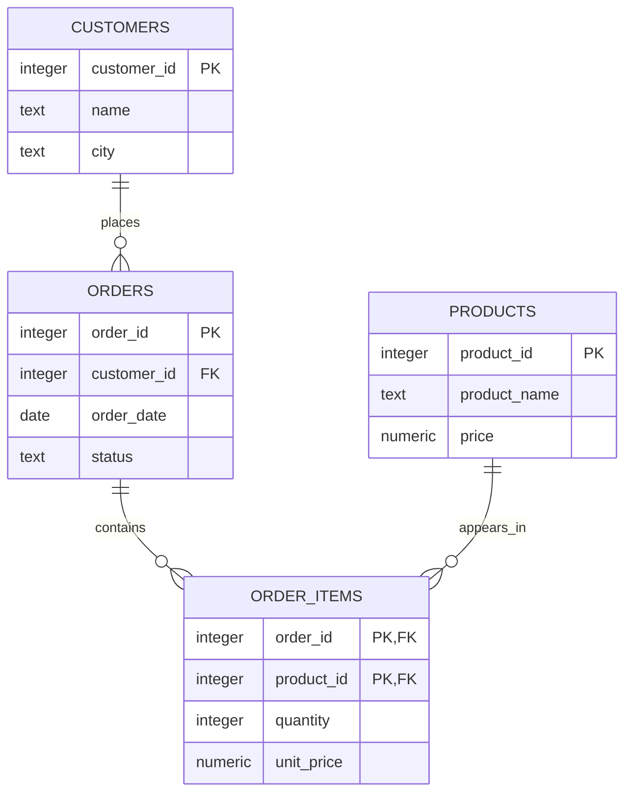

# 02 · Relational foundations

[Home](../README.md) · [Next: selecting](03-select-and-filter.md)

A **database** is an organized collection of data. A **DBMS** is the software that manages it. A relational database stores data in tables and links related records using keys. A **schema** is a namespace for objects inside a database; this lab uses `public`.

| Term | Plain meaning | Harbor Shop example |
| --- | --- | --- |
| Table | A collection of records with named columns | `customers` |
| Row / record | One item in that collection | Customer 1, Amina |
| Column / field | One kind of attribute | `city` |
| Data type | What kind of value a column accepts | `text`, `integer`, `date` |
| Primary key (PK) | Unique, non-null row identifier | `customer_id` |
| Foreign key (FK) | Reference to a key in another table | `orders.customer_id` |
| Constraint | Rule enforced by the database | `quantity > 0` |
| Query | Request to read or change data | `SELECT ...` |
| Result set | Rows produced by a query | Customers from Dublin |
| Grain | What one row represents | One order vs one order item |

## The practice tables

| Table | One row means | Important columns |
| --- | --- | --- |
| `customers` | One customer | ID, name, city, email, signup date |
| `products` | One product | ID, name, category, current price |
| `orders` | One purchase attempt | ID, customer ID, date, status |
| `order_items` | One product line in an order | Order ID, product ID, quantity, sale price |



`||` represents one; `o{` represents zero or many. The database permits an order with no items while it is being built. In this seed data every order has at least one item.

An order has many items; a product can appear in many orders. `order_items` is a **junction table** that resolves that many-to-many relationship. Its composite primary key `(order_id, product_id)` permits one line per product per order. This is a design choice, not a universal requirement.

## Types you will see

| PostgreSQL type | Use | Example |
| --- | --- | --- |
| `integer` / `bigint` | Whole numbers, IDs, counts | `3` |
| `numeric(10,2)` | Exact decimal money in this lab | `19.50` |
| `double precision` | Approximate scientific measurements | Sensor values |
| `text` | Variable-length text | `'Dublin'` |
| `varchar(n)` | Text with a length cap | `varchar(100)` |
| `boolean` | True/false; also nullable unless constrained | `TRUE` |
| `date` | Calendar date | `DATE '2026-01-05'` |
| `timestamp` | Date/time without time zone | Local scheduled wall time |
| `timestamptz` | An instant displayed in the session time zone | Event creation time |
| `jsonb` | Structured JSON, PostgreSQL feature | Metadata |

`numeric` avoids binary floating-point rounding surprises for exact prices. A generated identity makes IDs convenient, but **PRIMARY KEY** still supplies the uniqueness rule.

## NULL is missing, not zero

`NULL` means missing/unknown/not applicable. It differs from `0`, `''`, and `FALSE`. Customer Eli has no city. Do not invent a city just to fill the field.

```sql
SELECT customer_id, name, city FROM customers ORDER BY customer_id;
```

| customer_id | name | city |
| --- | --- | --- |
| 1 | Amina | Dublin |
| 2 | Ben | Cork |
| 3 | Clara | Dublin |
| 4 | Diego | Galway |
| 5 | Eli | NULL |

## Normalization, without jargon overload

Normalization reduces repeated facts and makes updates safer.

- **1NF:** keep individual values in columns, rather than a comma-separated list of product IDs in one cell.
- **2NF:** facts in a table with a composite key should depend on the whole key. Product name belongs in `products`, not copied into every item.
- **3NF:** avoid storing facts about another non-key attribute. Customer contact details belong in `customers`, not repeated in each order.

A stored historical sale price is deliberate: it is a fact about that sale line. Changing `products.price` should not change a January sales report.

## SQL statement families

| Family | Typical statements | Purpose |
| --- | --- | --- |
| DQL (common teaching label) | `SELECT` | Read |
| DML | `INSERT`, `UPDATE`, `DELETE` | Change rows |
| DDL | `CREATE`, `ALTER`, `DROP` | Define objects |
| Transaction control | `BEGIN`, `COMMIT`, `ROLLBACK` | Group changes |
| Access control | `GRANT`, `REVOKE` | Permissions |

Use lowercase unquoted table/column names and uppercase keywords for readability. PostgreSQL folds unquoted identifiers to lowercase. Strings use single quotes: `'Dublin'`; double quotes name identifiers: `"MixedCaseColumn"`. End statements with a semicolon. Comments start with `--` or use `/* ... */`.

**Try it:** explain why an order ID cannot identify an individual row in `order_items`. Answer: several item rows can share the same order ID; you need the product ID too in this design.
