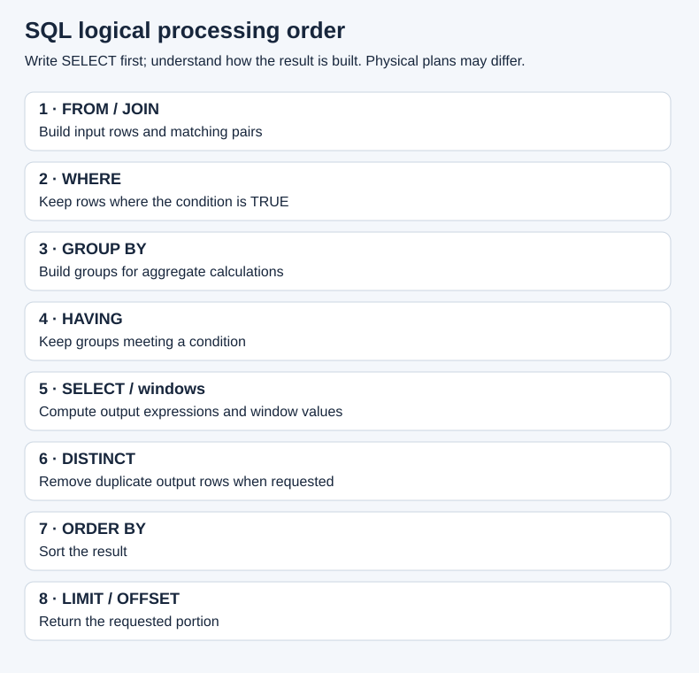

# 03 · SELECT, filters, sorting, and NULL

[Home](../README.md) · [Next: aggregation](04-aggregation.md)

**SELECT** chooses output columns; **FROM** identifies the input table; **WHERE** keeps rows whose condition is TRUE.

```sql
SELECT name, city
FROM customers
WHERE city = 'Dublin'
ORDER BY name;
```

Result: Amina and Clara. `SELECT *` returns all columns; name the columns you need in reusable reports.

## Syntax and reading order

```sql
SELECT DISTINCT column_name
FROM table_name
WHERE condition
ORDER BY column_name ASC
LIMIT 10;
```

This is a **template**, not a query against the shop; replace placeholders. `ASC` is ascending (default); `DESC` is descending.



Conceptual processing order: `FROM/JOIN → WHERE → GROUP BY → HAVING → SELECT/window expressions → DISTINCT → ORDER BY → LIMIT/OFFSET`. The optimizer may physically execute operations differently. A SELECT alias is available in ORDER BY, but not in WHERE or HAVING in PostgreSQL.

```sql
SELECT product_name, price * 1.10 AS adjusted_price
FROM products
WHERE price * 1.10 > 20
ORDER BY adjusted_price DESC, product_id;
```

`AS` names a result column; it does not change the table.

## DISTINCT removes duplicate result rows

```sql
SELECT DISTINCT city FROM customers ORDER BY city NULLS LAST;
SELECT DISTINCT city, active FROM customers ORDER BY city NULLS LAST, active;
```

The first returns Cork, Dublin, Galway, and one NULL. The second deduplicates the **whole selected combination**. It does not independently deduplicate each column. Avoid DISTINCT as a reflex to hide a join mistake.

## Comparison and logical operators

| Operator | Meaning | Example predicate |
| --- | --- | --- |
| `=` | Equal | `city = 'Dublin'` |
| `<>` or `!=` | Different | `status <> 'cancelled'` |
| `>`, `>=`, `<`, `<=` | Compare | `price >= 12` |
| `AND` | Both conditions TRUE | `active AND city = 'Dublin'` |
| `OR` | At least one TRUE | `city = 'Cork' OR city = 'Galway'` |
| `NOT` | Negate | `NOT active` |
| `IS NULL` | Value missing | `city IS NULL` |
| `IS NOT NULL` | Value present | `city IS NOT NULL` |

```sql
SELECT name FROM customers
WHERE active AND (city = 'Dublin' OR city = 'Cork')
ORDER BY customer_id;
```

Result: Amina, Ben, Clara. `AND` binds more tightly than `OR`; parentheses make your intention clear. Without them, the filter might let through an inactive Cork customer.

## NULL uses three-valued logic

`city = NULL` does not test for missing data. A comparison involving NULL usually produces UNKNOWN. WHERE keeps TRUE and discards FALSE and UNKNOWN.

| Expression | Result |
| --- | --- |
| `NULL = NULL` | UNKNOWN |
| `NULL IS NULL` | TRUE |
| `NULL <> 'Dublin'` | UNKNOWN |
| `TRUE AND NULL` | UNKNOWN |
| `FALSE AND NULL` | FALSE |
| `TRUE OR NULL` | TRUE |
| `NOT NULL` | UNKNOWN |

```sql
SELECT name FROM customers WHERE city IS NULL; -- Eli
SELECT name FROM customers
WHERE city <> 'Dublin' OR city IS NULL
ORDER BY customer_id; -- Ben, Diego, Eli
```

`IS DISTINCT FROM` offers a PostgreSQL null-safe comparison:

```sql
SELECT name FROM customers
WHERE city IS DISTINCT FROM 'Dublin'
ORDER BY customer_id;
```

## IN and NOT IN

```sql
SELECT name FROM customers WHERE city IN ('Dublin', 'Cork');
SELECT name FROM customers WHERE city NOT IN ('Dublin', 'Cork');
```

The second returns Diego, not Eli. Missing city is UNKNOWN. An additional trap is a NULL **inside the list/subquery**: `2 NOT IN (1, NULL)` is UNKNOWN, so it passes no WHERE filter. Use `NOT EXISTS` for anti joins when the compared data can be NULL.

## BETWEEN includes both endpoints

```sql
SELECT product_name, price FROM products
WHERE price BETWEEN 8 AND 30
ORDER BY price, product_id;
```

Result: Notebook 8, Mug 12, Desk Lamp 30. This means `price >= 8 AND price <= 30`.

For date/time ranges, half-open intervals are often clearer:

```sql
SELECT order_id FROM orders
WHERE order_date >= DATE '2026-02-01'
  AND order_date < DATE '2026-03-01'
ORDER BY order_id; -- 3, 4, 5
```

This pattern also works for timestamps and avoids accidentally excluding the last day's afternoon events.

## LIKE and ILIKE

| Pattern | Meaning |
| --- | --- |
| `'D%'` | Starts with D |
| `'%Lamp%'` | Contains Lamp |
| `'_en'` | Exactly one character followed by en |
| `'A%'` | Starts with uppercase A under ordinary case-sensitive LIKE behavior |

`%` matches zero or more characters; `_` matches one. PostgreSQL `ILIKE` provides case-insensitive pattern matching under the active locale.

```sql
SELECT name FROM customers WHERE name LIKE '_en'; -- Ben
SELECT product_name FROM products WHERE product_name ILIKE '%lamp%'; -- Desk Lamp
```

To search for a literal wildcard, use an escape character: `LIKE '%!%%' ESCAPE '!'` finds text containing a literal percent sign.

## ORDER BY, LIMIT, OFFSET

```sql
SELECT product_id, product_name, price FROM products
ORDER BY price DESC, product_id ASC
LIMIT 2;
```

Result: Backpack 40, Desk Lamp 30. The ID breaks ties predictably. SQL does not guarantee row order without ORDER BY. LIMIT without a deterministic ORDER BY does not mean “the first two inserted rows.”

```sql
SELECT product_id, product_name FROM products
ORDER BY product_id LIMIT 2 OFFSET 2; -- products 3 and 4
```

OFFSET skips rows. For large changing datasets, keyset pagination (`WHERE product_id > last_seen_id ORDER BY product_id LIMIT ...`) can be preferable.

**Try it:** select active Dublin customers sorted by newest signup first. Use `active AND city = 'Dublin'` and `ORDER BY signup_date DESC, customer_id`.
