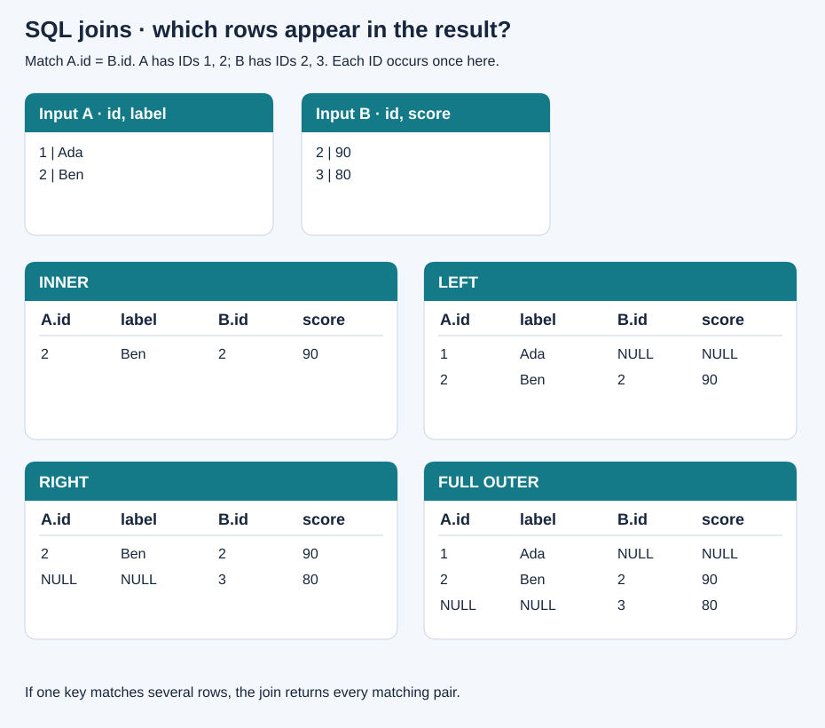

# 05 · Joins and set operations

[Home](../README.md) · [Next: functions](06-functions-and-dates.md)

A **join** combines rows from different table expressions using a matching condition. It combines columns; set operators such as UNION stack compatible rows.

## See the actual rows



The illustration uses small illustrative tables A `(id,label)` and B `(id,score)` outside the shop. A has IDs 1 and 2; B has IDs 2 and 3. They match on ID 2. Real joins can return many matching pairs; a join is not simply a set intersection.

| Join | Keeps |
| --- | --- |
| INNER JOIN | Matching pairs only |
| LEFT JOIN | Matching pairs plus every unmatched left row |
| RIGHT JOIN | Matching pairs plus every unmatched right row |
| FULL OUTER JOIN | Matching pairs plus unmatched rows from both sides |
| CROSS JOIN | Every left/right row combination |

Unmatched-side columns are filled with NULL. `LEFT OUTER JOIN` and `LEFT JOIN` are equivalent; similarly for RIGHT and FULL.

## INNER JOIN

```sql
SELECT o.order_id, c.name, o.status
FROM orders o
INNER JOIN customers c ON c.customer_id = o.customer_id
ORDER BY o.order_id;
```

Six rows, one per order. Amina appears twice because she has two orders. ON states the match; aliases (`o`, `c`) shorten qualified column names and avoid ambiguous references.

## LEFT JOIN and finding missing matches

```sql
SELECT c.customer_id, c.name, o.order_id
FROM customers c
LEFT JOIN orders o ON o.customer_id = c.customer_id
ORDER BY c.customer_id, o.order_id;
```

Eight rows: six matches, plus one preserved row each for Diego and Eli. Neither has an order.

```sql
SELECT c.name
FROM customers c
LEFT JOIN orders o ON o.customer_id = c.customer_id
WHERE o.order_id IS NULL
ORDER BY c.customer_id; -- Diego, Eli
```

This is an **anti join**: left rows with no match. Test a joined column guaranteed non-null when a match exists, such as the primary key; testing a nullable city would not prove there was no match.

## The ON-versus-WHERE trap

To keep **all customers** and attach only paid orders:

```sql
SELECT c.name, o.order_id
FROM customers c
LEFT JOIN orders o
 ON o.customer_id = c.customer_id AND o.status = 'paid'
ORDER BY c.customer_id, o.order_id;
```

Result: Amina 1/3, Ben 2, Clara 6, Diego NULL, Eli NULL → six rows.

Putting `WHERE o.status = 'paid'` after that LEFT JOIN discards NULL-extended rows and returns only the four paid orders. Outer join matching is decided in ON; WHERE runs on the joined result.

## RIGHT and FULL

```sql
SELECT c.name, o.order_id
FROM orders o
RIGHT JOIN customers c ON c.customer_id = o.customer_id
ORDER BY c.customer_id, o.order_id;
```

Equivalent to customers LEFT JOIN orders. Put the table you want to preserve on the left when that makes reading easier.

```sql
SELECT c.name, o.order_id
FROM customers c
FULL OUTER JOIN orders o ON o.customer_id = c.customer_id
ORDER BY c.customer_id, o.order_id;
```

In this schema every order has a valid non-null customer foreign key, so there are no right-only orders. This FULL JOIN therefore has the same rows as the LEFT JOIN. The original figure shows the general case with unmatched rows on both sides.

## CROSS JOIN

```sql
SELECT c.name, p.product_name
FROM customers c CROSS JOIN products p
ORDER BY c.customer_id, p.product_id;
```

5 × 5 = **25** combinations. Useful for constructing grids; easy to produce accidental huge outputs if you forget a joining condition.

## Self join

A table may appear twice with different aliases. Find pairs of customers in the same city:

```sql
SELECT a.name AS person_a, b.name AS person_b, a.city
FROM customers a
JOIN customers b
 ON a.city = b.city AND a.customer_id < b.customer_id;
```

Result: Amina/Clara/Dublin. `<` avoids self-pairs and reversed duplicates. NULL cities do not match under `=`.

## Several joins and row multiplication

```sql
SELECT o.order_id, c.name, p.product_name, oi.quantity,
       oi.quantity * oi.unit_price AS line_total
FROM orders o
JOIN customers c ON c.customer_id = o.customer_id
JOIN order_items oi ON oi.order_id = o.order_id
JOIN products p ON p.product_id = oi.product_id
WHERE o.status = 'paid'
ORDER BY o.order_id, p.product_id;
```

Seven paid item rows. An order with two items appears twice. `COUNT(o.order_id)` here counts item rows; `COUNT(DISTINCT o.order_id)` counts orders.

Joining two independent one-to-many child tables can multiply their rows: two items × three payments = six pairs for one order. Aggregate each child to order grain before combining them, or choose the correct grain explicitly. DISTINCT does not repair a duplicated SUM.

## UNION, UNION ALL, INTERSECT, EXCEPT

Inputs need the same number of columns with compatible types. The output names normally come from the first SELECT.

```sql
SELECT city FROM customers WHERE active
UNION
SELECT city FROM customers WHERE NOT active
ORDER BY city NULLS LAST;
```

UNION removes duplicate entire rows: Cork, Dublin, Galway, NULL. UNION ALL keeps duplicates and usually avoids deduplication work.

```sql
SELECT customer_id FROM customers
INTERSECT
SELECT customer_id FROM orders; -- 1, 2, 3

SELECT customer_id FROM customers
EXCEPT
SELECT customer_id FROM orders; -- 4, 5
```

INTERSECT keeps common result rows; EXCEPT keeps left result rows absent on the right. Without ALL, duplicates are removed. Use a final ORDER BY if output order matters.

**Try it:** list products never ordered. Expected: Backpack. Use LEFT JOIN on product ID plus `WHERE oi.product_id IS NULL`, or NOT EXISTS.
