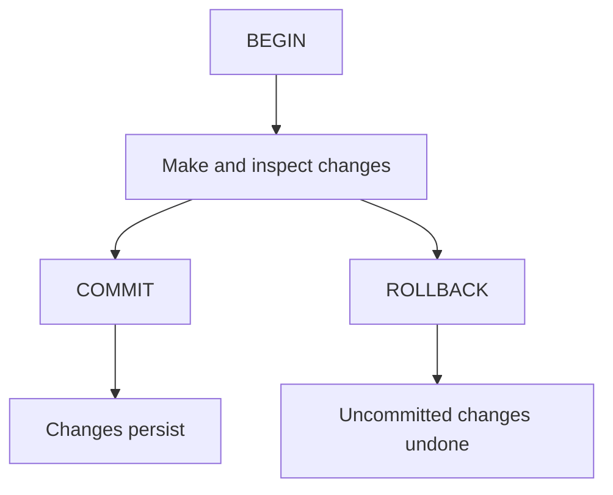

# 10 · Transactions and concurrency

[Home](../README.md) · [Next: windows](11-window-functions.md)

A **transaction** groups operations into one unit. COMMIT saves the unit; ROLLBACK cancels its uncommitted changes. PostgreSQL executes each standalone statement in a transaction too; an explicit BEGIN lets several statements share one.

## ACID

| Property | Meaning |
| --- | --- |
| Atomicity | All operations in the transaction succeed together, or their changes are undone |
| Consistency | Declared rules remain enforced across successful changes |
| Isolation | Concurrent work interacts according to the isolation level |
| Durability | Committed changes survive under the database's durability guarantees |

The database enforces declared constraints; it cannot infer every business rule. Isolation does not mean all transaction levels prevent every possible anomaly.

## Safe rehearsal

```sql
BEGIN;
SELECT customer_id, active FROM customers WHERE customer_id = 5;
UPDATE customers SET active = FALSE WHERE customer_id = 5 RETURNING customer_id, active;
ROLLBACK;
SELECT active FROM customers WHERE customer_id = 5; -- TRUE again
```

For an intended persistent change use COMMIT instead. In Query Tool, verify whether autocommit is enabled; do not assume a statement is still undoable after it has committed.



## Savepoints

```sql
BEGIN;
UPDATE customers SET city = 'Limerick' WHERE customer_id = 5;
SAVEPOINT city_changed;
UPDATE customers SET active = FALSE WHERE customer_id = 5;
ROLLBACK TO SAVEPOINT city_changed;
SELECT city, active FROM customers WHERE customer_id = 5; -- Limerick, TRUE
ROLLBACK; -- also undo the city change
```

A savepoint provides a point to return to within the current transaction. After an error PostgreSQL normally marks the transaction aborted; issue ROLLBACK, or roll back to a suitable earlier savepoint, before proceeding.

## Concurrency and isolation

PostgreSQL uses **MVCC**, which maintains row versions so readers can see appropriate snapshots while other transactions work. Locks still exist for writes, DDL, and explicit locking.

- **Read Committed (default):** each statement sees data committed before that statement started. Consecutive reads can see different committed data.
- **Repeatable Read:** uses a transaction snapshot for stable repeated reads, but it does not guarantee every transaction execution is serializable.
- **Serializable:** aims for effects equivalent to a serial ordering; conflicting transactions may be aborted and need retry.
- PostgreSQL treats **Read Uncommitted** as Read Committed.

A read-then-write application can lose an intended update if it computes a new value outside the database using stale data. For simple counters, an atomic `UPDATE ... SET quantity = quantity + 1` avoids that particular stale-value pattern. For complex multi-step rules, choose suitable locking or isolation and retry handling.

```sql
BEGIN;
SELECT customer_id FROM customers WHERE customer_id = 1 FOR UPDATE;
-- Do a related, deliberate update while this row lock is held.
ROLLBACK;
```

FOR UPDATE locks selected rows against conflicting row changes until the transaction ends. Keep transactions short. Two sessions locking rows in different orders can deadlock; use a consistent order and retry failed transactions when appropriate.

**Interview prompt:** does ROLLBACK mean an identity ID is reused? No. Sequence increments generally survive rollback, so gaps are normal.

Reference: [official transaction tutorial](https://www.postgresql.org/docs/current/tutorial-transactions.html).
